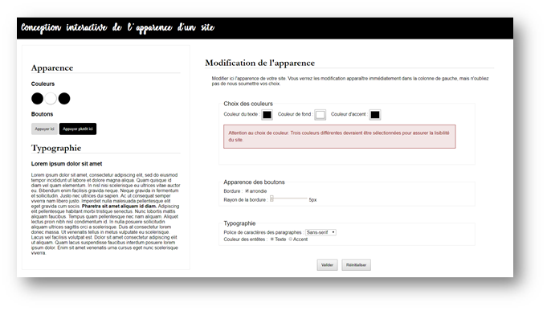

# Manipulation du DOM avec JavaScript

## Mise en contexte

À l’aide des fichiers fournis, vous allez créer une page web interactive qui permet aux utilisateurs de choisir l’apparence de quelques éléments de leur page à l’aide d’un formulaire. 
Lorsque les utilisateurs modifient un champ du formulaire, un aperçu de leurs choix sera mis automatiquement à jour (colonne de gauche.)

Lorsque les utilisateurs soumettront leur formulaire, une validation des champs de couleur avec JavaScript sera effectuée. 
Il sera vérifié que trois couleurs différentes ont été utilisées sinon le formulaire sera invalide et un message d’erreur sera affiché. 
Voici un exemple du site terminé qui affiche une erreur après que le formulaire a été soumis avec deux couleurs identiques.



Si un formulaire valide est soumis, une page de remerciement, qui comprend une vidéo, est affichée.

## Objectifs

Pratiquer :

- L'analyse d'un projet de développement et la détermination des tâches à effectuer
- L'utilisation appropriée du langage de balisage (HTML)
- L'utilisation appropriée des feuilles de styles (CSS)
- L'intégration correcte des éléments multimédia
- La manipulation adéquate des objets du modèle DOM 
- La validation des formulaires à l'aide de scripts

## Instructions

### 1. Ajout des différents fichiers aux pages

Ajouter les scripts, la mise en forme et les bibliothèques aux fichiers `.html` 

- Attention à l'ordre des fichiers importés

- Ne pas retirer 

  ```html
   <link href="https://fonts.googleapis.com/css2?family=Dancing+Script&display=swap" rel="stylesheet">
   <link href="https://fonts.googleapis.com/icon?family=Material+Icons" rel="stylesheet">
  ```
   Ces fichiers permettent d'importer la police Dancing Script et des icônes.

### 2. Compléter le HTML

- [ ] Structurer la page à l'aide de balises sémantiques (voir `apercu.png`)
- [ ] Tout le texte fourni est sous forme de paragraphes. Remplacer les paragraphes par des balises plus appropriées lorsque nécessaire pour assurer une hiérarchie de l'information adéquate (voir `apercu.png`)
- [ ] Compléter le formulaire pour en faire un formulaire valide qui envoie correctement toutes les données.
  - Pour les boutons, on doit pouvoir choisir s'ils sont arrondis ou non et à quel point (bordure et rayon de la bordure).
  - Pour la couleur des entêtes, on choisit si les entêtes sont de la même couleur que le texte ou si elles sont de la couleur accent.
- [ ] Ajouter la propriété adéquate au formulaire pour que les données soient envoyées à `merci.html`
- [ ] Télécharger et ajouter une vidéo à `merci.html` (utiliser les propriétés adéquates pour respecter les normes vues en classe)

### 3. Compléter la mise en forme 

Pour compléter la mise en forme, voir `apercu.png`.

- [ ] Télécharger une image libre de droit et la mettre comme image de fond de l'entête dans `style.css`
- [ ] Compléter la mise en forme du formulaire (`forms.css`)
- [ ] Compléter la mise en forme de l'application (`style.css`)

### 4. Compléter le fichier script.js

- [ ] Écrire le code nécessaire pour que l'aperçu soit automatiquement mis à jour quand quelque chose est modifié dans les choix de conception
- [ ] Écrire le code nécessaire pour empêcher la soumission du formulaire si trois couleurs différentes n'ont pas été choisies
